# ⚡ Ride the Lightning

**A universal, local studio that turns real, sourced data into broadcast-quality animated charts — for YouTube, Reels, Shorts and Premiere.**
Every number on screen comes from a verifiable row of data. 28 chart models · 72 countries · SEC filings for US-listed companies · 4,400+ ready-to-use series.

<p align="center"></p>

> **The rule nobody else follows:** no number is ever typed by hand. Text uses markers (`{valor}`, `{cambio:N}`…) that the compiler computes from the data; a stray digit is a compile error. Each piece ships with a verification report that maps every figure to series, column, date and row.

---

## Contents
[Gallery](#gallery) · [Quick start](#quick-start) · [How it works](#how-it-works) · [Chart models](#chart-models) · [Data](#data) · [Examples](#examples) · [Accuracy rules](#accuracy-rules) · [Professional output](#professional-output) · [CLI / MCP / Chat](#front-doors) · [Documentation](#documentation) · [Licenses](#licenses-and-data-terms) · [Language note](#language-note)

---

## Gallery

Real data, real frames (final frame of each animation). Vertical versions follow the reel safe zone. Full catalog with usage rules: [docs/MODELS.md](docs/MODELS.md).

| | | |
|:--:|:--:|:--:|
| 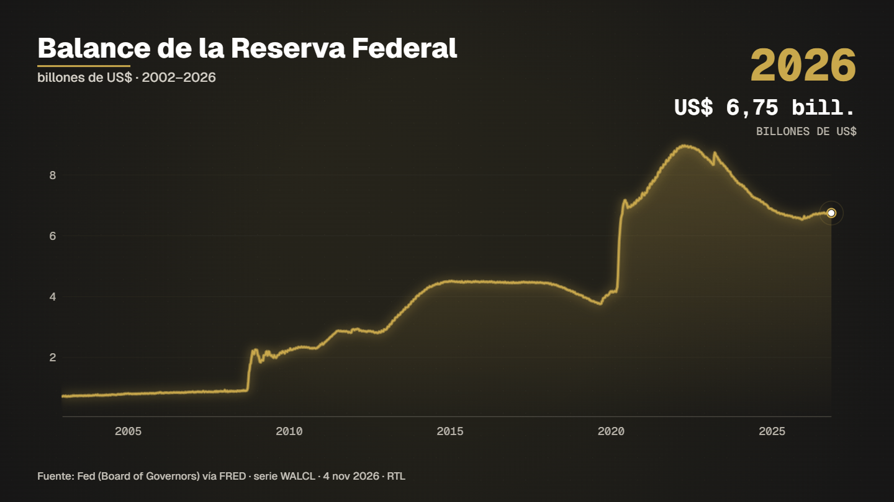<br>**Story of one figure** | 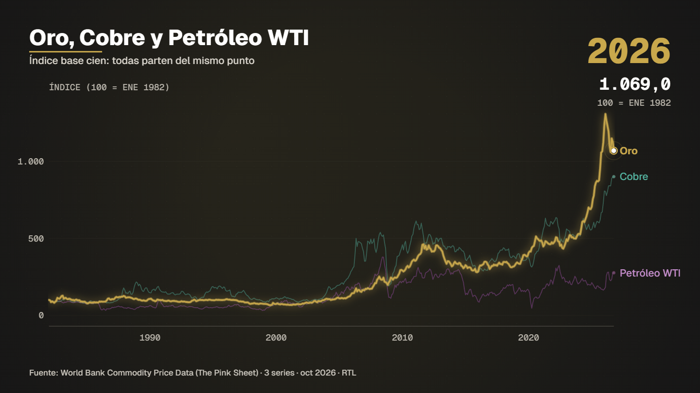<br>**One against the rest** | 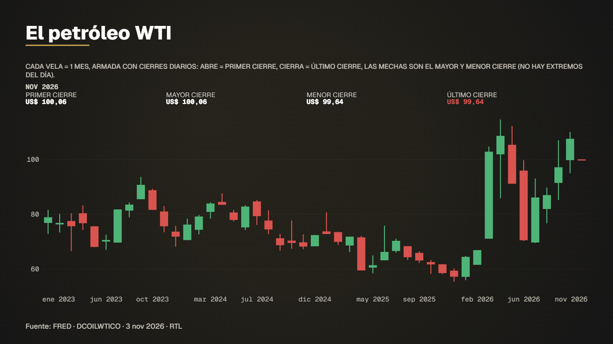<br>**Candlesticks** |
| 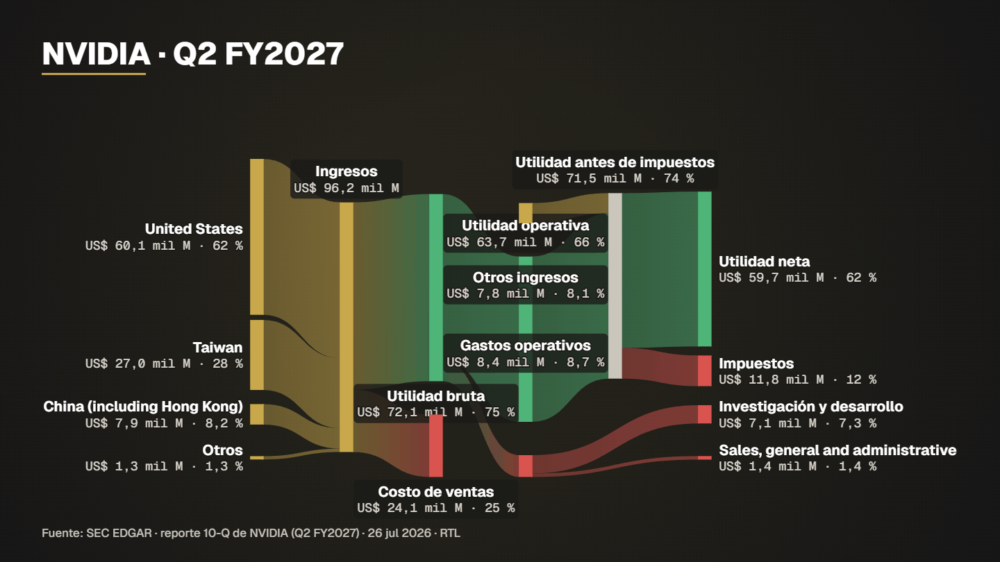<br>**How a company makes money** (SEC) | 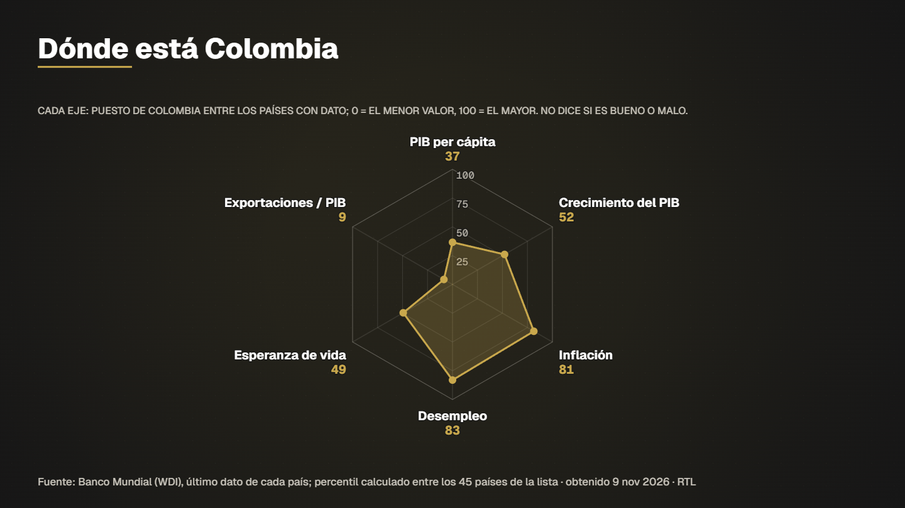<br>**Country profile (radar)** | 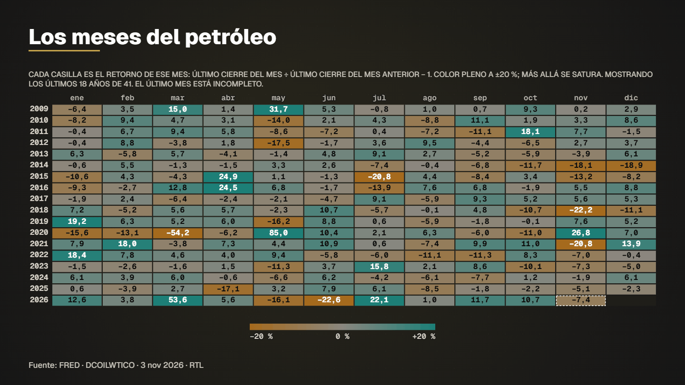<br>**Calendar heat map** |
| 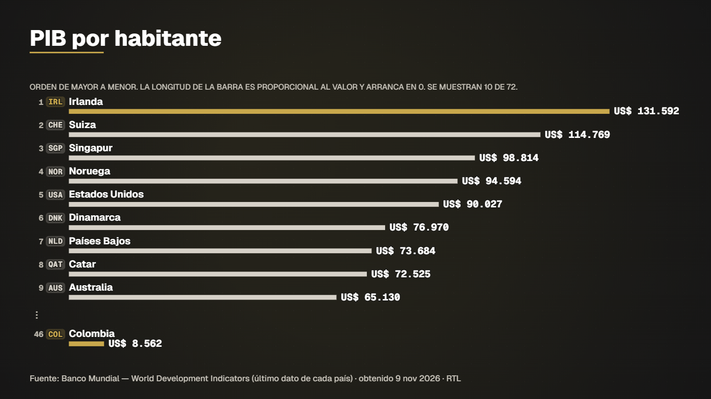<br>**Country ranking** | 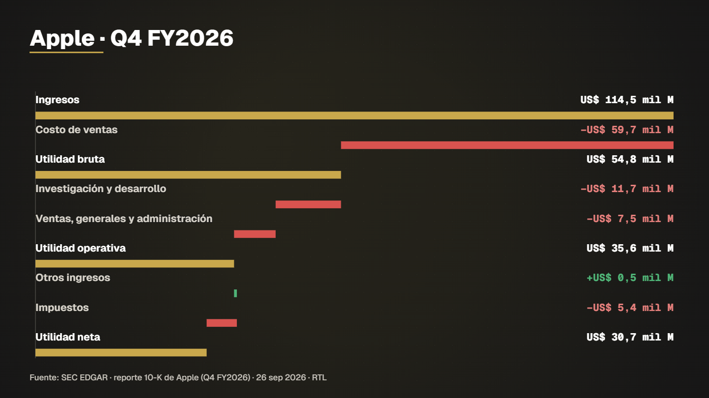<br>**Waterfall** | 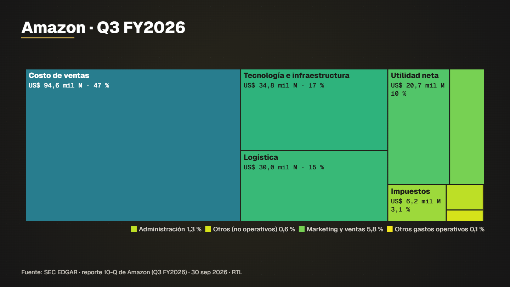<br>**Treemap** |
| 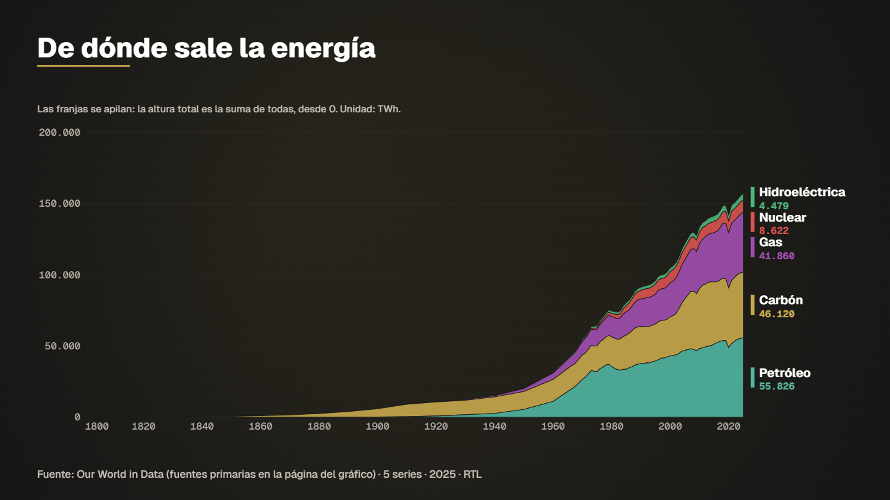<br>**Stacked area** | 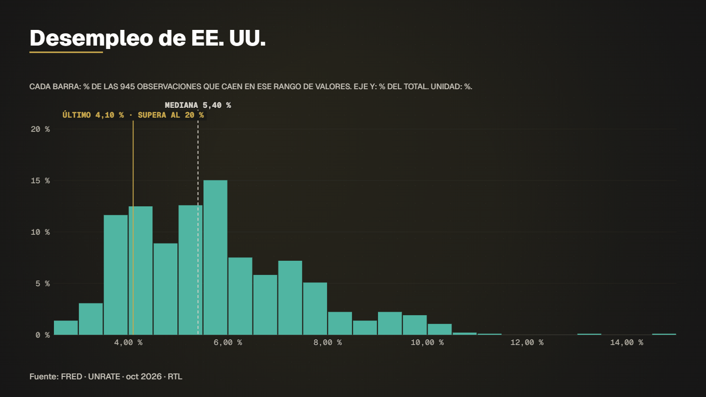<br>**Histogram** | 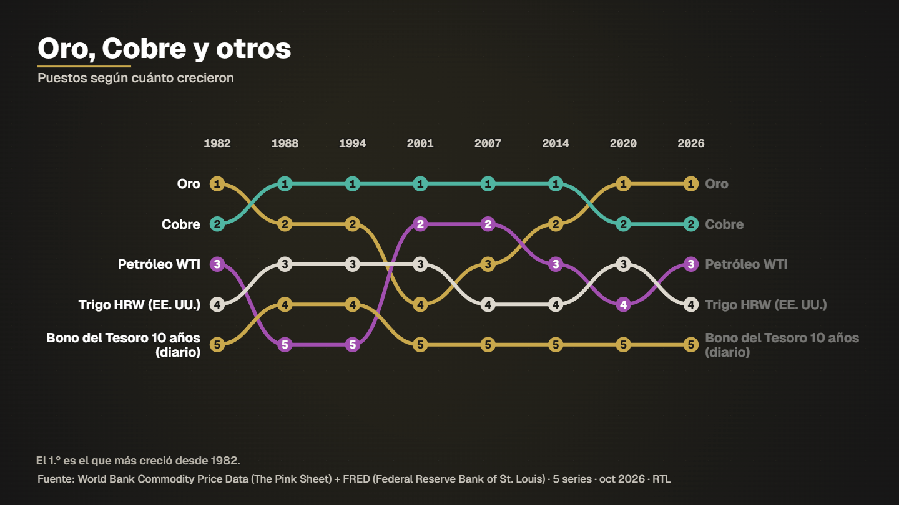<br>**Bump chart** |

**Vertical (9:16, reel-safe)**

| 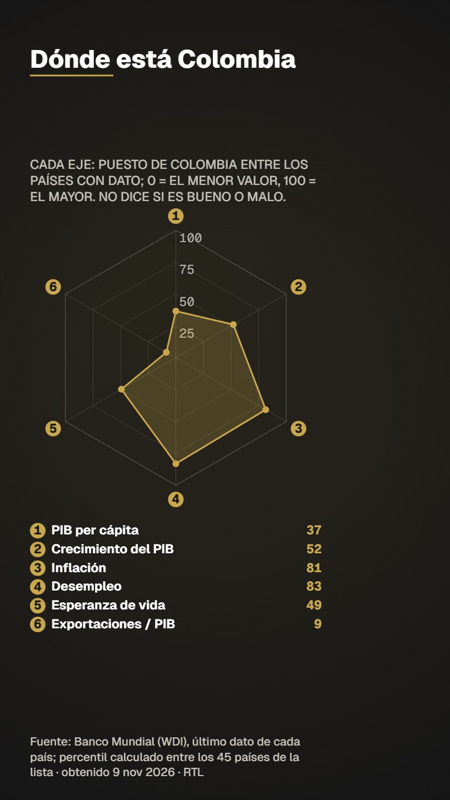 | 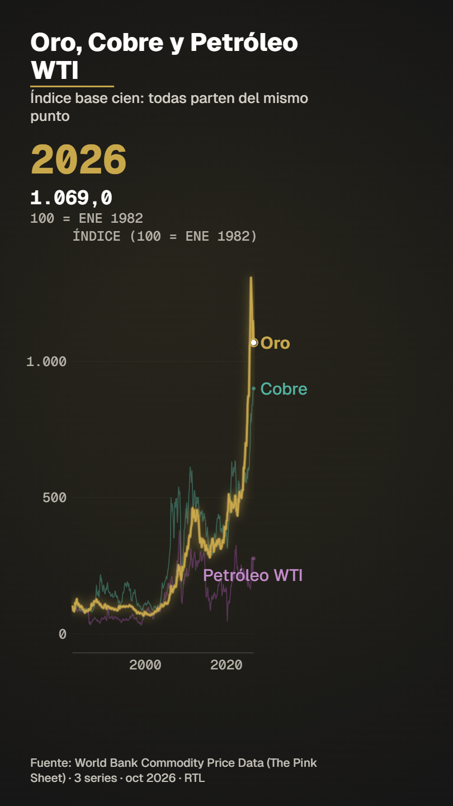 | 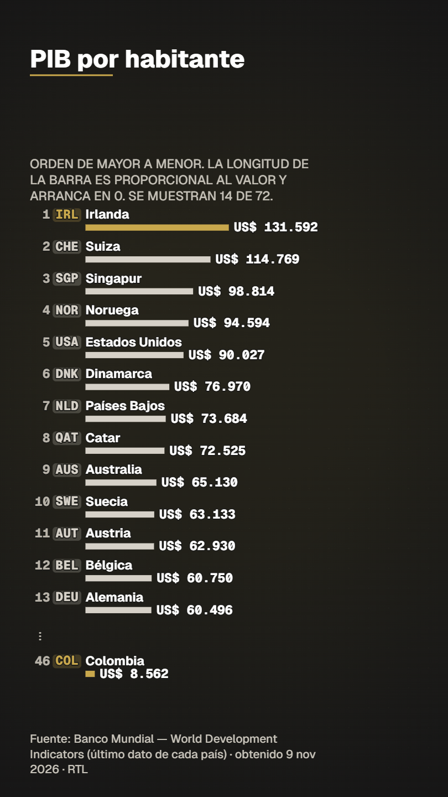 | 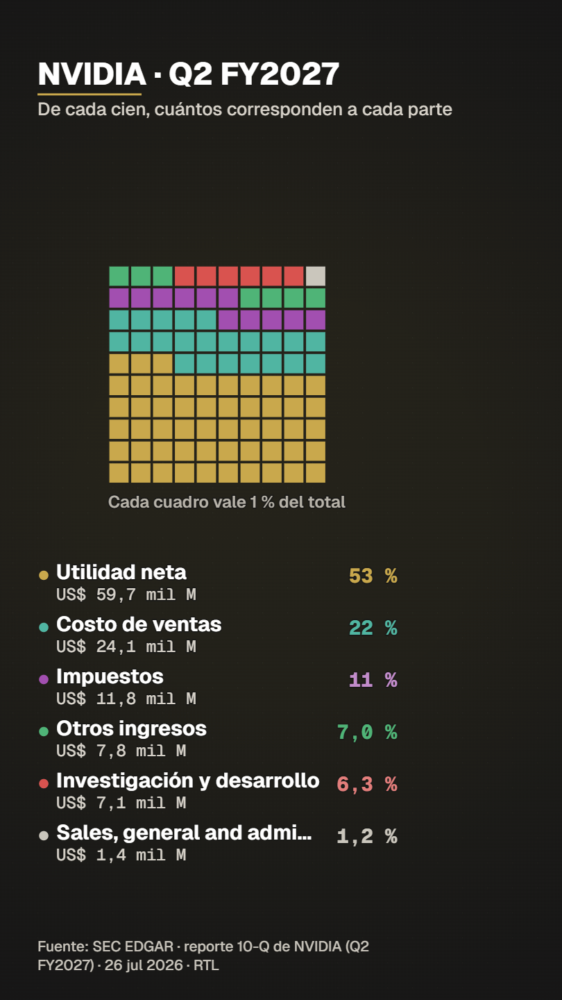 | 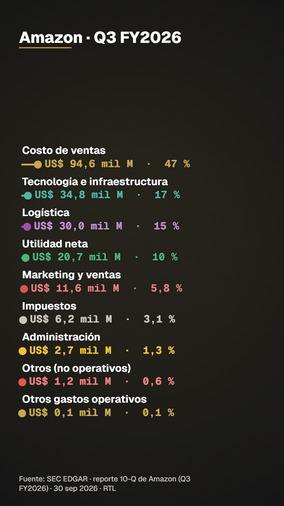 |
|:--:|:--:|:--:|:--:|:--:|

All 64 images (32 cases × horizontal/vertical): [`docs/gallery/`](docs/gallery/). Regenerate with `npm run gallery`.

---

## Quick start

**Requirements:** [Node.js](https://nodejs.org) 22+, [FFmpeg](https://ffmpeg.org) on the PATH, Microsoft Edge or Google Chrome. Works on Windows, macOS and Linux (the one-click installers are Windows `.bat` files).

```bash
git clone https://github.com/TimothyArcher90/Ride-the-Lightning.git
cd Ride-the-Lightning
npm install
node servidor/estudio.mjs          # opens the studio at http://127.0.0.1:5180
```

No account, no API key, no cloud: everything runs on your machine and the server only listens on `127.0.0.1`.

**Try it without downloading anything** — the repo ships a curated, open-license data snapshot in [`data/`](data/) and ready-to-run [examples](examples/):

```bash
node servidor/cli.mjs compilar examples/gold-copper-oil/spec.json     # compile + verification report
node servidor/cli.mjs vista    examples/gold-copper-oil/spec.json 4,12,18   # PNG of seconds 4, 12 and 18
node servidor/cli.mjs render   examples/gold-copper-oil/spec.json --borrador # fast draft MP4
```

### The studio in 4 steps
1. **What to show** — a data series over time · a country (key figures, or compare countries) · how a company makes money (SEC) · what added and what subtracted · parts of a whole · your own file (Excel/CSV/JSON).
2. **How to view it** — a *live gallery*: every chart style that fits your data is drawn with **your** data before you choose; the best fit is marked ★ with the reason.
3. **Camera and pace** — one recommended setting; advanced options folded away.
4. **Review and download** — draft (~30 s) or final (MP4 + ProRes 4444 with alpha + verification report).

**Language switch:** the **EN | ES** button in the studio header sets the language of the interface *and* of the piece (titles, units, month names, notes). It defaults to English unless your browser is in Spanish, and your choice is remembered. The command line takes `--lang=es|en` (or `RTL_LANG`), and the MCP server and the chat follow `RTL_LANG`.

Guide: [docs/USER_GUIDE.md](docs/USER_GUIDE.md).

---

## How it works

```
data catalog + connectors  →  templates & visualizer  →  compiler  →  deterministic engine  →  headless render + ffmpeg
 (FRED, World Bank, IMF,       (data shape → spec;        (spec → plan +   (canvas-2D, pure        (MP4, ProRes 4444
  Eurostat, SEC, OWID, …)       "which chart fits?")        verification)    layers, no randomness)    with alpha)
```
Deep dive: [docs/ARCHITECTURE.md](docs/ARCHITECTURE.md). Spec & layer reference: [docs/SPEC_REFERENCE.md](docs/SPEC_REFERENCE.md).

Highlights
- **Autonomous visualizer** — give it data, it picks the chart models that tell it well (rules from *From Data to Viz*, the FT Visual Vocabulary and Cleveland–McGill), builds several genuinely different options, compiles each, runs the collision audit, and keeps only those that pass.
- **Deterministic frames** — a frame is a pure function of `(plan, time)`; the same spec renders the same pixels, so output can be reviewed frame by frame.
- **Nothing overlaps** — every text box is registered; the renderer refuses to export a piece with overlapping text.
- **Camera in data space** — zoom and pan on the data, so text stays crisp.
- **Live data** — an updater refreshes each series on its own cadence and can re-render pieces marked `"vivo"`.

---

## Chart models

28 models (30 ids counting variants such as stacked 100 % and returns histogram) in four groups — see [docs/MODELS.md](docs/MODELS.md) for inputs, selection rules, honesty notes and images of each.

| Group | Models (id) |
|---|---|
| **Time series** | story of one figure (`historia`), one against the rest (`comparar`), small multiples (`panel`), bars (`barras`), bar-chart race (`carrera`), stacked area absolute / 100 % (`apilada`, `apilada100`), grouped bars (`agrupadas`), bump / rank over time (`bump`), candlesticks (`velas`), histogram of values / of returns (`histograma`, `retornos`), calendar heat map (`calendario`), one series from two milestone dates (`dos_hitos`), this year vs. historical range (`bandas`), bullet / gauge vs. history (`bullet`) |
| **Several series, different units** | slope chart (`pendiente`), diverging bars of % change (`divergente`), correlation heat map (`correlacion`), scatter with OLS + R² (`dispersion`), radar profile of a country or entity (`radar`) |
| **Parts of a total** | donut (`donut`), treemap (`treemap`), waffle — "each square = 1 %" (`waffle`), lollipop (`lollipop`), pictogram (`pictograma`), ranking with country codes (`ranking`) |
| **Flows and bridges** | Sankey for company income statements (`sankey`), waterfall (`cascada`), dumbbell before/after (`dumbbell`) |

Scales are always honest: log axes, base-100 indices, rank-by-growth and "other N parts" groupings are **declared on screen**. When all series share a unit (e.g. several countries in "% of GDP"), real values are shown on a common axis; an index is only used when units differ.

---

## Data

- **Catalog:** 4,400+ series with source, URL, license, frequency and unit (`catalogo/series.json`); downloaded on demand with provenance (URL, date, sha256, first/last real data point). **No interpolation, ever.**
- **Countries:** 72 countries (all of the G20 and all of continental Latin America) × up to 59 indicators — GDP, GDP per capita, real growth, public debt (% of GDP), fiscal balance, inflation, unemployment, population, life expectancy, Gini, current account, reserves, exports, FDI, energy, emissions, health, education, trade… What a source does not publish is not created and never interpolated. A country "card" shows the latest real value of each indicator with its year and source. See [docs/COUNTRIES.md](docs/COUNTRIES.md).
- **Companies:** quarterly income statements from **SEC EDGAR (XBRL)** for US-listed companies — Sankey, waterfall and donut inputs. See [docs/QUARTERLY_REPORTS.md](docs/QUARTERLY_REPORTS.md).
- **Your own data:** drop Excel (`xlsx xls xlsb ods`), `csv tsv`, `json`. RTL only asks what it cannot infer (date order, decimal separator, **source**). No source → it will not compile.
- **Offline snapshot:** [`data/`](data/) holds 2,400+ open-license series (CC BY 4.0 and public domain; exact copies, nothing trimmed or altered) so most examples run without any download. Restricted sources (Yahoo, IMF, Coin Metrics, CC BY-SA/NC) are never included.

| Source | License / terms (summary) | Notes |
|---|---|---|
| World Bank | CC BY 4.0 | Indicators, commodities (Pink Sheet) |
| SEC EDGAR | Public domain | Company filings (XBRL) |
| Our World in Data | CC BY | Energy, emissions, long history |
| Eurostat | CC BY | EU statistics |
| US Treasury FiscalData | Public domain | Debt, rates |
| FRED | Per series (check each) | Macro and markets |
| IMF DataMapper | Free to view; **bulk/commercial reuse needs written permission** | Flagged *restricted* in the studio |
| Yahoo Finance | Personal use only | Flagged *restricted*; never redistributed in this repo |
| Coin Metrics | CC BY-NC | Flagged *restricted* |

Full details, endpoints, limits and verification records: [docs/DATA_SOURCES.md](docs/DATA_SOURCES.md) · [docs/DATA_FORMAT.md](docs/DATA_FORMAT.md) · [docs/data-verification.md](docs/data-verification.md).

**Cross-checked, not assumed:** 80 spot checks against the official sources found 0 discrepancies in the new series, and GDP, debt/GDP, inflation and population were compared between World Bank, IMF and Eurostat for every country; real discrepancies between sources (e.g. Ireland's GDP, Sweden's 2025 inflation, Ethiopia's population) are shown to the user as a visible note on the country card.

---

## Examples

15 ready-to-run examples in [`examples/`](examples/) — each has a `spec.json`, a README (what it shows, source, data license), a preview image and, where relevant, a vertical spec. Index: [docs/EXAMPLES.md](docs/EXAMPLES.md).

| Example | Shows |
|---|---|
| `gold-copper-oil` | Three commodities on a comparable scale |
| `fed-balance-sheet` | The Fed's balance sheet with key moments detected from the data |
| `colombia-radar-45-countries` | Where Colombia stands among 45 countries on six indicators |
| `gdp-per-capita-ranking` | Country ranking with a highlighted protagonist |
| `nvidia-how-it-makes-money` | Revenue → profit Sankey from SEC filings |
| `apple-revenue-to-profit` | Waterfall from revenue to net income |
| `amazon-dollar-treemap` | Where each dollar of revenue goes |
| `nvidia-per-100-dollars` | "Per 100 dollars" waffle |
| `global-energy-mix` | Energy mix over time (stacked area) |
| `energy-race` | Ranking race of energy sources |
| `oil-monthly-returns-calendar` | Calendar heat map of monthly returns |
| `eurusd-daily-returns` | Distribution of daily returns |
| `wti-candlesticks` | Candlesticks (closes-only mode, declared) |
| `latam-debt-to-gdp` | Public debt of six Latin American countries (spec only — IMF data terms) |
| `bitcoin-full-history` | Complete history, log scale (spec only — CC BY-NC data) |

---

## Accuracy rules

Enforced by the compiler, not by good intentions.

1. **No typed numbers.** Text uses markers computed from data; a stray digit is an error unless the layer declares `"verificada": {"fuente","url"}`.
2. **Every series has a source** (URL, download date, sha256, first/last real data point). No source → no compile.
3. **Complete series by default.** Trimming with `desde`/`hasta` is flagged.
4. **No guessing:** ambiguous dates (`03/04/2020`), undeclared decimal commas, text in a numeric column, an anchor with no nearby data → error with row and value.
5. **Verification report** with every compile and next to every render: each figure → series, column, date, row, raw value.
6. **License warnings** when a source restricts commercial use.
7. **Estimates are labelled** (e.g. IMF WEO values for the current year "may be estimates").

---

## Professional output

A single design system ([`motor/diseno.js`](motor/diseno.js)) drives all 28 models in both formats:

- **Type scale with enforced minimums** (vertical 1080 px wide: labels ≥ 40 px, axes/units ≥ 32, footer ≥ 28), WCAG contrast ≥ 4.5:1.
- **Mandatory source footer** on every piece: *"Source: <name> · <date of last data point> · RTL"*.
- **Reel safe zone** (nothing at `x ≥ 72.2 %` and `y ≥ 43.75 %` in 9:16).
- **Motion:** Material easing curves (never linear UI motion), 40 ms stagger, annotation cards stay ≥ 3 s, one protagonist per shot.
- **Deliverables:** reference MP4 (`libx264 -crf 17 -preset slow -yuv420p`) **and** ProRes 4444 with alpha for Premiere. No burned-in subtitles.

An automated checklist (`node scripts/prueba-calidad.mjs`) measures the real canvas text and verifies all of this for 17 models × 2 formats (the 16 base ones plus `dos_hitos`; the other extras are covered by `prueba-universal`).

---

## Front doors

```bash
# Studio (web UI)
node servidor/estudio.mjs

# CLI
node servidor/cli.mjs buscar gold                 # search the catalog
node servidor/cli.mjs bajar bm_gold               # full history + provenance
node servidor/cli.mjs compilar  <spec.json>       # compile + verification report
node servidor/cli.mjs vista     <spec.json> 4,12  # PNG frames at those seconds
node servidor/cli.mjs auditar   <spec.json>       # no text may overlap (checked every 0.2 s)
node servidor/cli.mjs render    <spec.json>       # MP4 + ProRes alpha (--borrador, --sin-alfa)
node servidor/cli.mjs vivo                        # permanent data updater

# Regenerate gallery + examples (~4 min)
npm run gallery
```

- **MCP server** (`servidor/mcp.mjs`, config in `.mcp.json`): lets Claude search series, generate pieces, preview frames, export, and run `proponer_visualizaciones`.
- **Chat panel** in the studio: edit the open piece by talking ("make it vertical", "show the previous quarter", "now as a waterfall"); uses your local Claude Code.

---

## Documentation

| Doc | What's inside |
|---|---|
| [docs/USER_GUIDE.md](docs/USER_GUIDE.md) | Using the studio, step by step |
| [docs/ARCHITECTURE.md](docs/ARCHITECTURE.md) | Layers, directory map, tests |
| [docs/SPEC_REFERENCE.md](docs/SPEC_REFERENCE.md) | The spec format and every layer |
| [docs/MODELS.md](docs/MODELS.md) | The 28 chart models with images and rules |
| [docs/EXAMPLES.md](docs/EXAMPLES.md) | The 15 examples and how to regenerate them |
| [docs/DATA_SOURCES.md](docs/DATA_SOURCES.md) · [DATA_FORMAT.md](docs/DATA_FORMAT.md) · [COUNTRIES.md](docs/COUNTRIES.md) · [data-verification.md](docs/data-verification.md) | Sources, formats, country coverage, verification |
| [docs/QUARTERLY_REPORTS.md](docs/QUARTERLY_REPORTS.md) | SEC company library and the filing watcher |
| [docs/STYLE_REFERENCES.md](docs/STYLE_REFERENCES.md) · [DIRECTION_GUIDE.md](docs/DIRECTION_GUIDE.md) | Visual language and direction guide |
| [docs/research/](docs/research/) | Visualization and animation research behind the design |
| [docs/PROFESSIONAL_PLAN.md](docs/PROFESSIONAL_PLAN.md) · [ROADMAP.md](docs/ROADMAP.md) · [COMPLIANCE.md](docs/COMPLIANCE.md) | Plan, status, what's done and what's limited |
| [CONTRIBUTING.md](CONTRIBUTING.md) | Add a model, add a data source, run the tests |

## Tests

```bash
npm run check                         # ALL suites, cheap ones first, summary + non-zero exit on failure (--rapido = cheap subset, --jobs=N parallel, --solo=name)
npm run salud                         # health check: ffmpeg/encoders, browser, fonts really loaded, catalogue drift, live-data freshness
npm run antes-de-subir                # ~10 s guard to run before `git push` (not a git hook): quick suites + instructions in sync
node scripts/prueba.mjs               # formats, accuracy rules, base chart types
node scripts/prueba-tablas.mjs        # table recognition (flows / categories / series)
node scripts/prueba-plantillas.mjs    # templates against the catalog
node scripts/prueba-visualizador.mjs  # visualizer options are distinct and pass the audit
node scripts/prueba-universal.mjs     # the 11 newer models
node scripts/prueba-calidad.mjs       # professional-quality checklist, 17 models × 2 formats + pixel decimation and colour-blind palette tests
node scripts/prueba-conectores.mjs    # connectors vs. live APIs (network)
node scripts/prueba-paises.mjs        # country cards and comparisons (network)
```

## Licenses and data terms

- **Code:** MIT ([LICENSE](LICENSE)). **Fonts:** Geist, SIL OFL ([`fuentes/OFL-Geist.txt`](fuentes/OFL-Geist.txt)).
- **Data:** each series keeps its own license; the studio shows a warning for restricted sources (Yahoo Finance: personal use; Coin Metrics: CC BY-NC; IMF: written permission for bulk/commercial reuse). If you monetize videos, check the source terms first. Only open-license data is redistributed in `data/`.
- **No non-commercial-only models or libraries** are used (the project is intended for commercial content).

## Language note

The studio UI and the text drawn *inside* the charts are available in **English and Spanish** (EN | ES switch in the studio header; `idioma: "en" | "es"` in a spec). Spanish is the original language of the project and of some data labels; the documentation, code-level docs and commit messages are in English. Original Spanish notes are kept in [`docs/es/`](docs/es/). Adding a language is one column in `web/i18n.js` (interface) and `motor/idioma.js` (drawn text).

---

*Born from [Electric Eye](https://github.com/TimothyArcher90/Electric_Eye) (animated maps): same proven architecture — deterministic headless rendering, MCP control, frame-by-frame review — with a chart engine instead of a map engine.*
