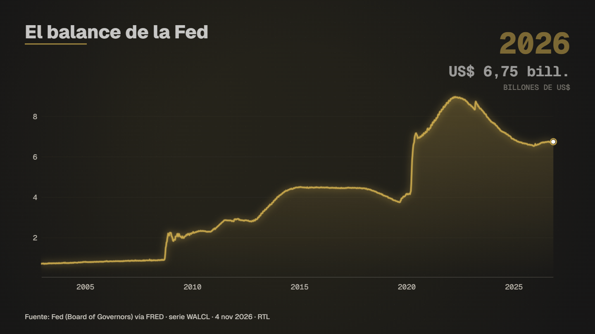
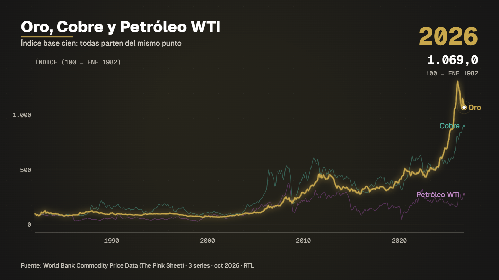
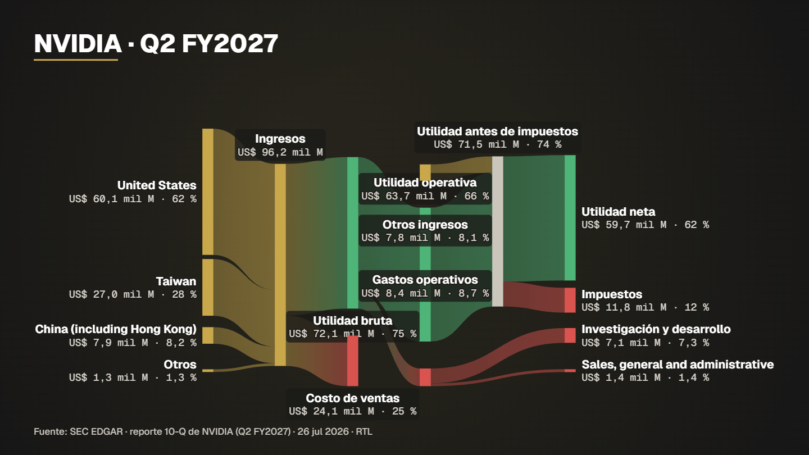
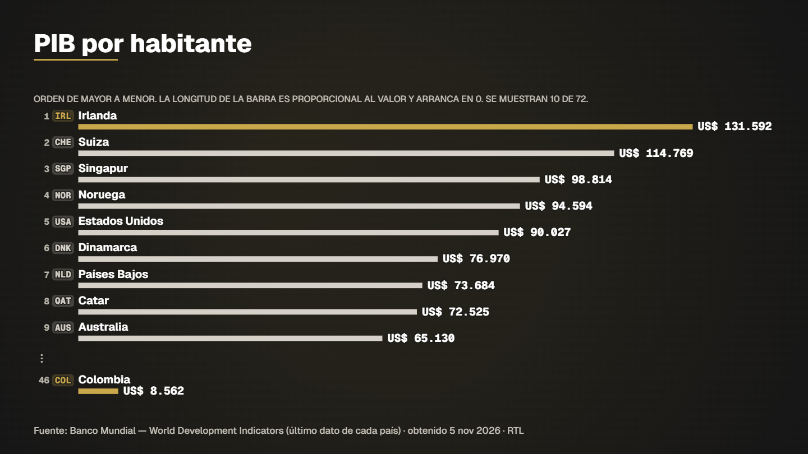
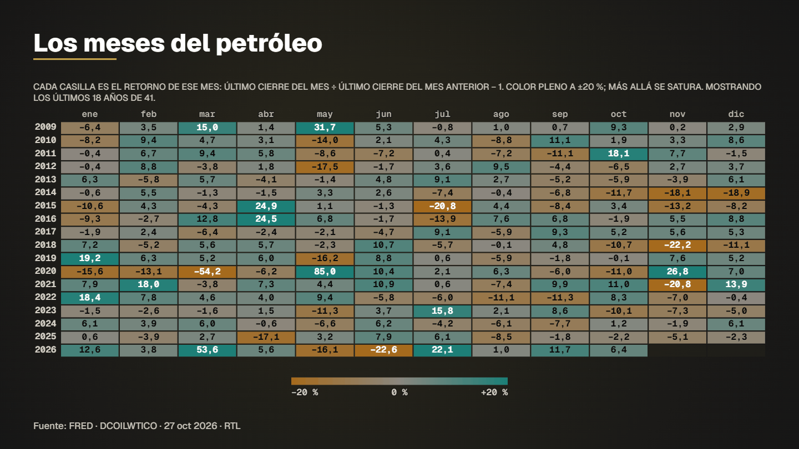
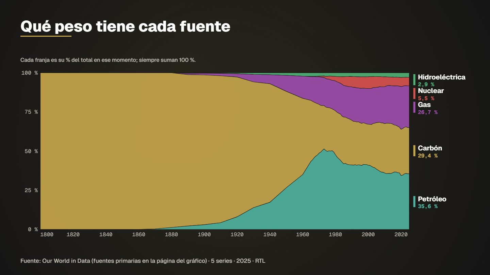

# Examples

Fifteen ready-to-run specs live in [`examples/`](../examples/). Each folder has `spec.json` (1920×1080), `spec.vertical.json` (1080×1920 for reels where it exists), a `README.md` (what it tells, source, licence, exact commands), a `preview.png` and, when the data is small and open, the derived `data.csv`. Series come from the data library (`datos/`, not versioned): each README lists the `bajar` command that fetches exactly what it needs.

Everything here is regenerated by one command (needs Edge or Chrome, ffmpeg and the data library):

```bash
npm run gallery                                   # docs/gallery + examples/ + examples/video
node scripts/generar-galeria.mjs --sin-video      # images and examples only
node scripts/generar-galeria.mjs --solo=radar-pais,ranking   # only some cases
```

Verify any example: `node servidor/cli.mjs compilar examples/<slug>/spec.json` (prints the report: every on-screen figure traced to a data row).

| Example | Model | What it shows | Data (licence) |
|---|---|---|---|
| [bitcoin-full-history](../examples/bitcoin-full-history/) | historia | Bitcoin since its first price, log scale | Coin Metrics (CC BY-NC) — **spec only** |
| [fed-balance-sheet](../examples/fed-balance-sheet/) | historia | Fed total assets since 2002 | Federal Reserve via FRED (public domain) |
| [latam-debt-to-gdp](../examples/latam-debt-to-gdp/) | comparar | Government debt / GDP of 6 Latin American countries | IMF WEO — **spec only** (permission needed) |
| [gold-copper-oil](../examples/gold-copper-oil/) | comparar | Gold, copper, WTI since 1960, indexed to 100 | World Bank (CC BY 4.0) |
| [colombia-radar-45-countries](../examples/colombia-radar-45-countries/) | radar | Colombia's rank among 45 countries in 6 indicators | World Bank (CC BY 4.0) |
| [gdp-per-capita-ranking](../examples/gdp-per-capita-ranking/) | ranking | GDP per capita of 45 countries, Colombia highlighted | World Bank (CC BY 4.0) |
| [oil-monthly-returns-calendar](../examples/oil-monthly-returns-calendar/) | calendario | Every month of WTI since 1986 as a heat square | EIA via FRED (public domain) |
| [eurusd-daily-returns](../examples/eurusd-daily-returns/) | retornos | Distribution of daily EUR/USD moves since 1999 | Federal Reserve H.10 via FRED (public domain) |
| [wti-candlesticks](../examples/wti-candlesticks/) | velas | WTI candlesticks (closes only, declared) | EIA via FRED (public domain) |
| [nvidia-how-it-makes-money](../examples/nvidia-how-it-makes-money/) | sankey | Revenue → costs → net income of the latest quarter | SEC EDGAR (public domain) |
| [apple-revenue-to-profit](../examples/apple-revenue-to-profit/) | cascada | Revenue to net income waterfall | SEC EDGAR (public domain) |
| [amazon-dollar-treemap](../examples/amazon-dollar-treemap/) | treemap | Where each Amazon dollar goes | SEC EDGAR (public domain) |
| [nvidia-per-100-dollars](../examples/nvidia-per-100-dollars/) | waffle | NVIDIA's money in 100 squares | SEC EDGAR (public domain) |
| [global-energy-mix](../examples/global-energy-mix/) | apilada100 | Share of coal, oil, gas, hydro, nuclear since 1800 | Our World in Data (CC BY 4.0) |
| [energy-race](../examples/energy-race/) | carrera | Which energy source leads, year by year | Our World in Data (CC BY 4.0) |

Previews (horizontal):

| | | |
|---|---|---|
|  |  |  |
|  |  |  |

The S&P 500 versions you may expect (calendar, returns histogram, candlesticks) use the same models: the daily S&P data in the library comes from Yahoo Finance (personal use only), so the shipped examples use WTI and EUR/USD instead. Locally, swap the series id for `yf_gspc` in the spec.

## Videos

[`examples/video/`](../examples/video/) holds draft renders (half resolution, 30 fps, no alpha) made with the same pipeline as the studio (`servidor/render.mjs`, calidad `borrador`), open-licence data only (World Bank, SEC, OWID, Federal Reserve). Total ≈ 1 MB; `README.gif` is a short loop for the README. Final delivery (1080p MP4 + ProRes 4444 with alpha) is `node servidor/cli.mjs render <spec>`.

| File | Format |
|---|---|
| `gold-copper-oil-h.mp4` | 16:9 |
| `nvidia-how-it-makes-money-h.mp4` | 16:9 |
| `global-energy-mix-h.mp4` | 16:9 |
| `fed-balance-sheet-h.mp4` | 16:9 |
| `colombia-radar-45-countries-v.mp4` | 9:16 |
| `gdp-per-capita-ranking-v.mp4` | 9:16 |

## Data licences at a glance

Public domain: SEC EDGAR, Federal Reserve/BLS/EIA/Census series via FRED (check each FRED series page). CC BY 4.0: World Bank, Our World in Data (check the primary source on the OWID chart page). **Not shipped:** Yahoo Finance (personal use), Coin Metrics community data (CC BY-NC), IMF data (systematic download and commercial reuse need written permission). The compiler warns when a spec reads a restricted licence.

## Known issues

Found while reviewing every image; none changes a figure.

- **Sankey in vertical** (fixed 2026-11-04): now a top-to-bottom layout from d3-sankey with row-staggered labels and leader lines; no label is truncated. Mid-level nodes carry the name only (no figures) because of the 40 px vertical type floor; the figures are in the first and last rows. Some SEC labels arrive with an HTML entity (`US &amp;` in Meta's segments).
- **Truncated subtitles** (`…`) in vertical when the library's template subtitle is long; the explanatory note above charts now wraps up to 6 lines in vertical, but template subtitles are still cut to the frame width.
- **Correlation heatmap in vertical** is small (4–5 series maximum); row names now wrap to two lines but a long name ("Bono del Tesoro 10 años (diario)") can still end in `…` there. The color scale is now the BrBG-based one (the old red/green scale had its center almost equal to the background).
- **Waffle and donut over a "where each dollar went" table** divide by costs + profit + non-operating income, so the total is revenue plus non-operating income, not revenue alone (stated in the example README).
- **Candlesticks** with only closing prices declare that wicks are the highest/lowest close; exact candles need OHLC columns, which no open source in the library provides.
- The 16 models' gallery uses sensible but not "directed" cameras; the curated specs (`fed-balance-sheet`, `bitcoin-full-history`) show hand-directed callouts.
- Fixed while building the gallery (`motor/`): carrera labels clipped at the left edge with long series names; the correlation values overlapped in small cells; scale notes cut with `…` in vertical; subtitles running past the right edge.
