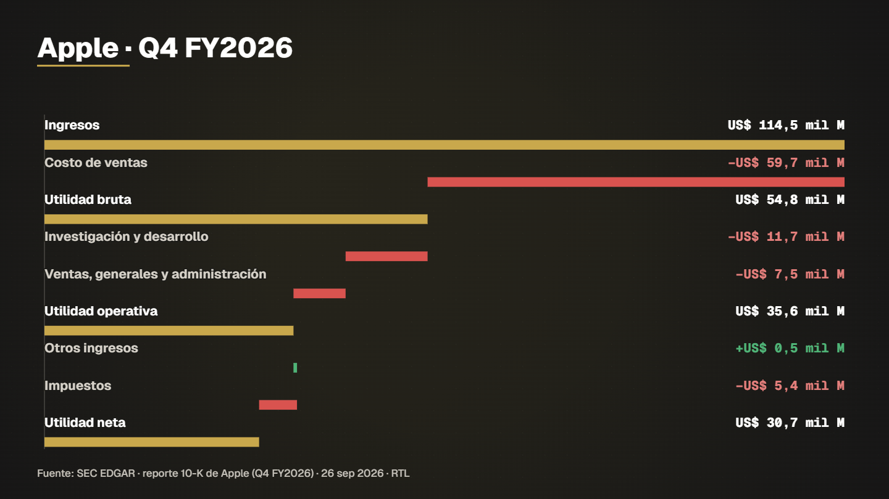

# Apple revenue to profit



**What it shows.** From revenue to net income in one waterfall: every cost steps the bar down; subtotals are checked against the report.

- **Model:** Waterfall — template `puente` (see [docs/MODELS.md](../../docs/MODELS.md))
- **Source:** SEC EDGAR: Apple latest 10-Q
- **Licence of the data:** Public domain (US government)
- **Data actually read by the spec:** 
  - SEC EDGAR · reporte 10-K de Apple (Q4 FY2026) — Dominio público (Gobierno de EE. UU.)
- **Duration / format:** 12 s, 1920×1080 (`spec.vertical.json` is the 1080×1920 version for reels)

## Run it

```bash
# the data (data.csv) is in this folder; nothing to download

# 2. compile: validates the spec and prints the verification report (every figure traced to a row)
node servidor/cli.mjs compilar examples/apple-revenue-to-profit/spec.json

# 3. preview frames (PNG in .tmp/vistas) and a fast draft video
node servidor/cli.mjs vista examples/apple-revenue-to-profit/spec.json 4,9
node servidor/cli.mjs render examples/apple-revenue-to-profit/spec.json --borrador --sin-alfa
```

Final delivery (MP4 + ProRes 4444 with alpha): `node servidor/cli.mjs render examples/apple-revenue-to-profit/spec.json`. Regenerate this folder with `npm run gallery`.

## Compiler notices (in Spanish, as the engine prints them)

- capas[0]:titulo.texto: contiene cifra escrita a mano ("Apple · Q4 FY2026") declarada verificada en Período del reporte Q4 FY2026 (SEC EDGAR, fecha de cierre 2026-09-26) · https://data.sec.gov/api/xbrl/companyfacts/CIK0000320193.json.
