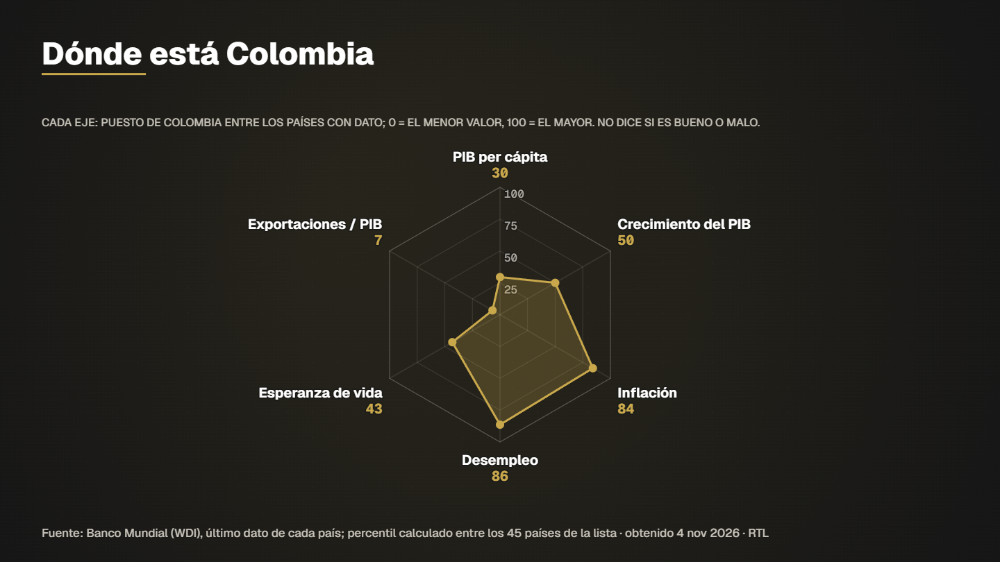

# Colombia radar 45 countries



**What it shows.** Colombia’s rank among 45 countries in GDP per capita, growth, inflation, unemployment, life expectancy and exports/GDP. It says where it sits, not whether that is good or bad.

- **Model:** Radar (table): Colombia among 45 countries — template `radar_tabla` (see [docs/MODELS.md](../../docs/MODELS.md))
- **Source:** World Bank WDI, latest value per country (6 indicators)
- **Licence of the data:** CC BY 4.0
- **Data actually read by the spec:** 
  - Banco Mundial (WDI), último dato de cada país; percentil calculado entre los 45 países de la lista — CC BY 4.0 (Banco Mundial)
- **Duration / format:** 11.2 s, 1920×1080 (`spec.vertical.json` is the 1080×1920 version for reels)

## Run it

```bash
# the data (data.csv) is in this folder; nothing to download

# 2. compile: validates the spec and prints the verification report (every figure traced to a row)
node servidor/cli.mjs compilar examples/colombia-radar-45-countries/spec.json

# 3. preview frames (PNG in .tmp/vistas) and a fast draft video
node servidor/cli.mjs vista examples/colombia-radar-45-countries/spec.json 4,9
node servidor/cli.mjs render examples/colombia-radar-45-countries/spec.json --borrador --sin-alfa
```

Final delivery (MP4 + ProRes 4444 with alpha): `node servidor/cli.mjs render examples/colombia-radar-45-countries/spec.json`. Regenerate this folder with `npm run gallery`.
