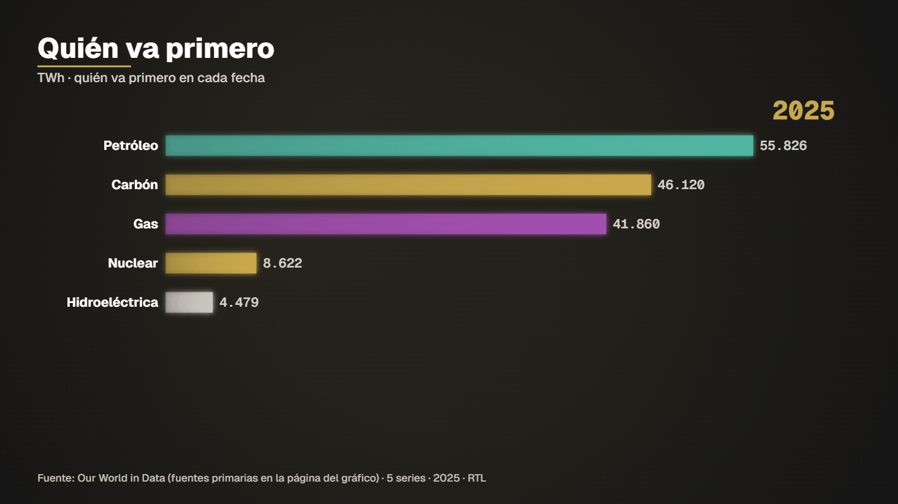

# Energy race



**What it shows.** Which energy source leads in each year since 1800: coal, oil, gas, hydro and nuclear racing in TWh.

- **Model:** Bar chart race — template `carrera` (see [docs/MODELS.md](../../docs/MODELS.md))
- **Source:** Our World in Data: global energy by source (TWh)
- **Licence of the data:** CC BY 4.0 (check the primary source on the OWID page)
- **Data actually read by the spec:** 
  - Series combinadas — combinación por fecha exacta de: Our World in Data · global-energy-substitution + Our World in Data · global-energy-substitution + Our World in Data · global-energy-substitution + Our World in Data · global-energy-substitution + Our World in Data · global-energy-substitution — see source
- **Duration / format:** 14 s, 1920×1080 (`spec.vertical.json` is the 1080×1920 version for reels)

## Run it

```bash
# the data (data.csv) is in this folder; nothing to download

# 2. compile: validates the spec and prints the verification report (every figure traced to a row)
node servidor/cli.mjs compilar examples/energy-race/spec.json

# 3. preview frames (PNG in .tmp/vistas) and a fast draft video
node servidor/cli.mjs vista examples/energy-race/spec.json 4,9
node servidor/cli.mjs render examples/energy-race/spec.json --borrador --sin-alfa
```

Final delivery (MP4 + ProRes 4444 with alpha): `node servidor/cli.mjs render examples/energy-race/spec.json`. Regenerate this folder with `npm run gallery`.
