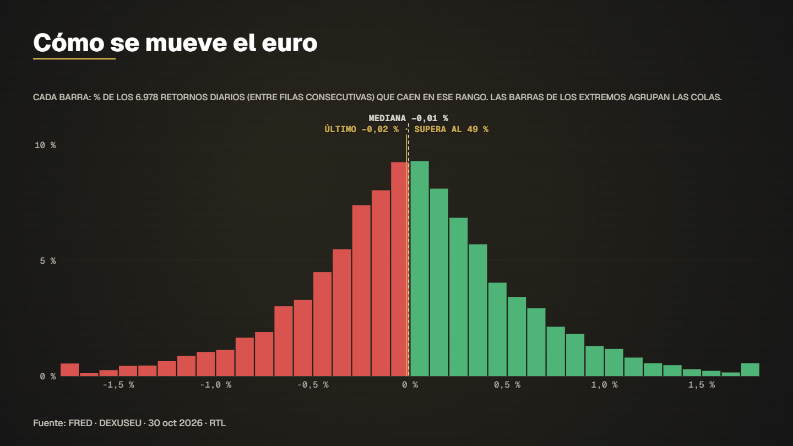

# Eurusd daily returns



**What it shows.** How often the euro moves a lot in one day against the dollar: the distribution of daily returns since 1999, median and last day marked.

- **Model:** Histogram (returns) — template `retornos` (see [docs/MODELS.md](../../docs/MODELS.md))
- **Source:** Federal Reserve H.10 via FRED: EUR/USD daily
- **Licence of the data:** Public domain (US government)
- **Data actually read by the spec:** 
  - FRED (Federal Reserve Bank of St. Louis) — Ver términos de la serie en FRED
- **Duration / format:** 11.2 s, 1920×1080 (`spec.vertical.json` is the 1080×1920 version for reels)

## Run it

```bash
# 1. download the series this example reads (the data folder is not versioned)
node servidor/cli.mjs bajar fred_dexuseu

# 2. compile: validates the spec and prints the verification report (every figure traced to a row)
node servidor/cli.mjs compilar examples/eurusd-daily-returns/spec.json

# 3. preview frames (PNG in .tmp/vistas) and a fast draft video
node servidor/cli.mjs vista examples/eurusd-daily-returns/spec.json 4,9
node servidor/cli.mjs render examples/eurusd-daily-returns/spec.json --borrador --sin-alfa
```

Final delivery (MP4 + ProRes 4444 with alpha): `node servidor/cli.mjs render examples/eurusd-daily-returns/spec.json`. Regenerate this folder with `npm run gallery`.
