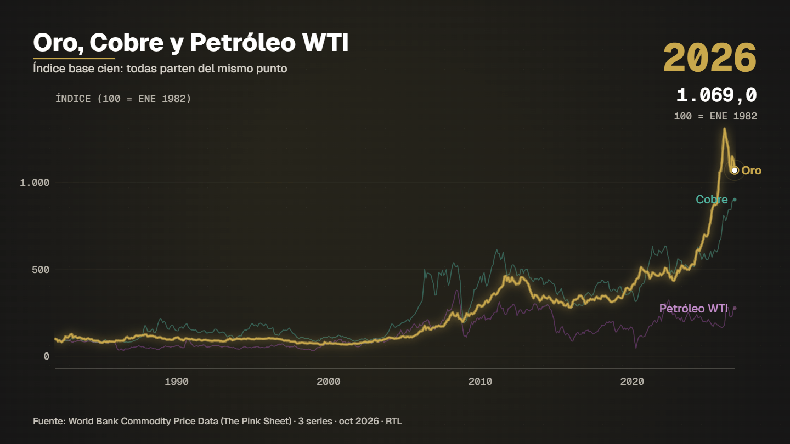

# Gold copper oil



**What it shows.** Gold, copper and WTI crude since 1960 on one common axis (indexed to 100 because the units differ), gold highlighted.

- **Model:** One against the rest — template `comparar` (see [docs/MODELS.md](../../docs/MODELS.md))
- **Source:** World Bank Pink Sheet: gold, copper, WTI crude
- **Licence of the data:** CC BY 4.0
- **Data actually read by the spec:** 
  - Series combinadas — combinación por fecha exacta de: Banco Mundial · Pink Sheet · Gold + Banco Mundial · Pink Sheet · Copper + Banco Mundial · Pink Sheet · Crude oil, WTI — see source
- **Duration / format:** 12 s, 1920×1080 (`spec.vertical.json` is the 1080×1920 version for reels)

## Run it

```bash
# the data (data.csv) is in this folder; nothing to download

# 2. compile: validates the spec and prints the verification report (every figure traced to a row)
node servidor/cli.mjs compilar examples/gold-copper-oil/spec.json

# 3. preview frames (PNG in .tmp/vistas) and a fast draft video
node servidor/cli.mjs vista examples/gold-copper-oil/spec.json 4,9
node servidor/cli.mjs render examples/gold-copper-oil/spec.json --borrador --sin-alfa
```

Final delivery (MP4 + ProRes 4444 with alpha): `node servidor/cli.mjs render examples/gold-copper-oil/spec.json`. Regenerate this folder with `npm run gallery`.
