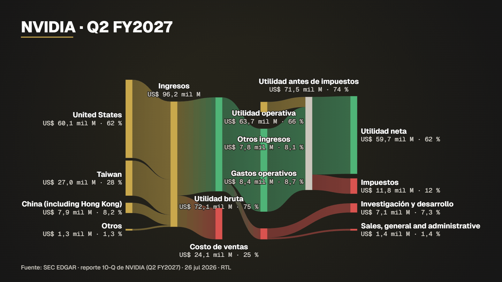

# Nvidia how it makes money



**What it shows.** NVIDIA’s latest quarter as a flow: revenue, cost of sales, R&D, operating expenses, taxes and what is left as net income. The 10-Q figures are derived so the diagram always balances.

- **Model:** Sankey flow — template `resultados` (see [docs/MODELS.md](../../docs/MODELS.md))
- **Source:** SEC EDGAR: NVIDIA latest 10-Q
- **Licence of the data:** Public domain (US government)
- **Data actually read by the spec:** 
  - SEC EDGAR · reporte 10-Q de NVIDIA (Q2 FY2027) — Dominio público (Gobierno de EE. UU.)
- **Duration / format:** 12.5 s, 1920×1080 (`spec.vertical.json` is the 1080×1920 version for reels)

## Run it

```bash
# the data (data.csv) is in this folder; nothing to download

# 2. compile: validates the spec and prints the verification report (every figure traced to a row)
node servidor/cli.mjs compilar examples/nvidia-how-it-makes-money/spec.json

# 3. preview frames (PNG in .tmp/vistas) and a fast draft video
node servidor/cli.mjs vista examples/nvidia-how-it-makes-money/spec.json 4,9
node servidor/cli.mjs render examples/nvidia-how-it-makes-money/spec.json --borrador --sin-alfa
```

Final delivery (MP4 + ProRes 4444 with alpha): `node servidor/cli.mjs render examples/nvidia-how-it-makes-money/spec.json`. Regenerate this folder with `npm run gallery`.

## Compiler notices (in Spanish, as the engine prints them)

- capas[0]:titulo.texto: contiene cifra escrita a mano ("NVIDIA · Q2 FY2027") declarada verificada en Período del reporte Q2 FY2027 (SEC EDGAR, fecha de cierre 2026-07-26) · https://data.sec.gov/api/xbrl/companyfacts/CIK0001045810.json.
