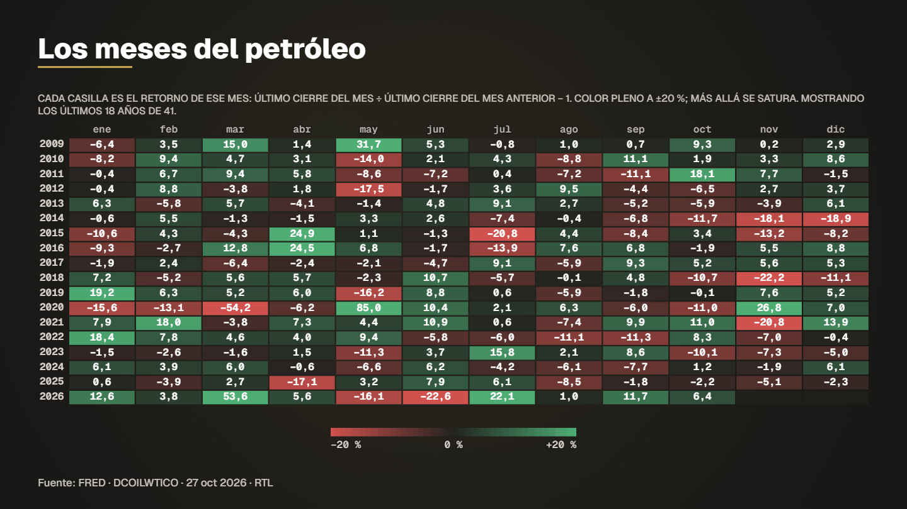

# Oil monthly returns calendar



**What it shows.** Every month of WTI crude since 1986 as a green/red square: seasonality and the worst years at a glance. (Swap `fred_dcoilwtico` for `yf_gspc` locally to get the S&P 500 version; Yahoo data is personal-use, so it is not shipped.)

- **Model:** Calendar heatmap — template `calendario` (see [docs/MODELS.md](../../docs/MODELS.md))
- **Source:** EIA via FRED: WTI crude daily, monthly returns
- **Licence of the data:** Public domain (US government)
- **Data actually read by the spec:** 
  - FRED (Federal Reserve Bank of St. Louis) — Ver términos de la serie en FRED
- **Duration / format:** 12.2 s, 1920×1080 (`spec.vertical.json` is the 1080×1920 version for reels)

## Run it

```bash
# 1. download the series this example reads (the data folder is not versioned)
node servidor/cli.mjs bajar fred_dcoilwtico

# 2. compile: validates the spec and prints the verification report (every figure traced to a row)
node servidor/cli.mjs compilar examples/oil-monthly-returns-calendar/spec.json

# 3. preview frames (PNG in .tmp/vistas) and a fast draft video
node servidor/cli.mjs vista examples/oil-monthly-returns-calendar/spec.json 4,9
node servidor/cli.mjs render examples/oil-monthly-returns-calendar/spec.json --borrador --sin-alfa
```

Final delivery (MP4 + ProRes 4444 with alpha): `node servidor/cli.mjs render examples/oil-monthly-returns-calendar/spec.json`. Regenerate this folder with `npm run gallery`.
