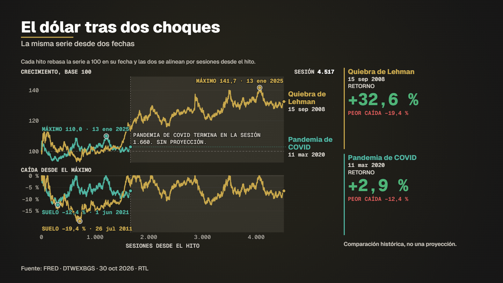

# Two milestones dollar



**What it shows.** The broad dollar index seen from two milestone dates: each rebased to 100 at its close and aligned by trading sessions since the milestone, with the drawdown from the running peak, a live table and two final figures. The younger series ends first and the screen says so (no projection). The Netscape/ChatGPT version of this piece is saved as `specs/ejemplo_dos_hitos_nasdaq.json` and fails on purpose until an open-licence Nasdaq-100 series exists.

- **Model:** Two milestones (same series from two dates) — template `dos_hitos` (see [docs/MODELS.md](../../docs/MODELS.md))
- **Source:** Federal Reserve via FRED: nominal broad US dollar index (DTWEXBGS), daily
- **Licence of the data:** Public domain (US government). Milestone dates verified on 2026-11-08 against official pages (each milestone carries its `fuente`): Lehman Holdings filed on 15 Sep 2008 ([FDIC](https://www.fdic.gov/analysis/2011-01/orderly-liquidation-lehman-brothers-holdings-inc-under-dodd-frank-act)); WHO characterized COVID-19 as a pandemic on 11 Mar 2020 ([WHO](https://www.who.int/news-room/speeches/item/who-director-general-s-opening-remarks-at-the-media-briefing-on-covid-19---11-march-2020)).
- **Data actually read by the spec:** 
  - FRED (Federal Reserve Bank of St. Louis) — Dominio público (obra del gobierno de EE. UU.: Board of Governors of the Federal Reserve System), redistribuida por FRED; citar la fuente
- **Duration / format:** 17.5 s, 1920×1080 (`spec.vertical.json` is the 1080×1920 version for reels)

## Run it

```bash
# 1. download the series this example reads (the data folder is not versioned)
node servidor/cli.mjs bajar fred_dtwexbgs

# 2. compile: validates the spec and prints the verification report (every figure traced to a row)
node servidor/cli.mjs compilar examples/two-milestones-dollar/spec.json

# 3. preview frames (PNG in .tmp/vistas) and a fast draft video
node servidor/cli.mjs vista examples/two-milestones-dollar/spec.json 4,9
node servidor/cli.mjs render examples/two-milestones-dollar/spec.json --borrador --sin-alfa
```

Final delivery (MP4 + ProRes 4444 with alpha): `node servidor/cli.mjs render examples/two-milestones-dollar/spec.json`. Regenerate this folder with `npm run gallery`.

## Compiler notices (in Spanish, as the engine prints them)

- capas[1] (g1):dos_hitos: «Pandemia de COVID» termina en la sesión 1660 y «Quiebra de Lehman» sigue hasta la 4517; la parte sin la serie corta se sombrea «sin proyección» y no se proyecta nada.
