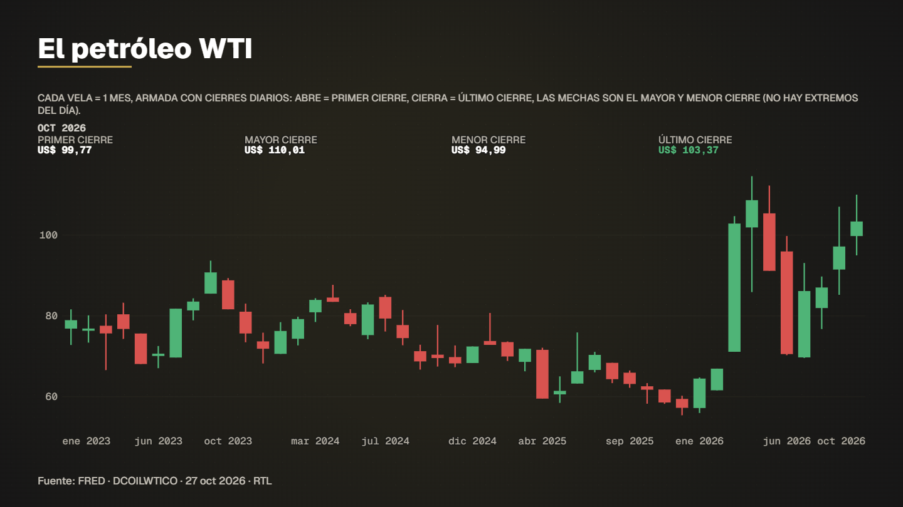

# Wti candlesticks



**What it shows.** WTI crude candlesticks since 2023. The source only has daily closes, so each candle groups a period and the screen says wick = highest/lowest close (not intraday extremes).

- **Model:** Candlesticks — template `velas` (see [docs/MODELS.md](../../docs/MODELS.md))
- **Source:** EIA via FRED: WTI crude daily (closes only)
- **Licence of the data:** Public domain (US government)
- **Data actually read by the spec:** 
  - FRED (Federal Reserve Bank of St. Louis) — Ver términos de la serie en FRED
- **Duration / format:** 12.2 s, 1920×1080 (`spec.vertical.json` is the 1080×1920 version for reels)

## Run it

```bash
# 1. download the series this example reads (the data folder is not versioned)
node servidor/cli.mjs bajar fred_dcoilwtico

# 2. compile: validates the spec and prints the verification report (every figure traced to a row)
node servidor/cli.mjs compilar examples/wti-candlesticks/spec.json

# 3. preview frames (PNG in .tmp/vistas) and a fast draft video
node servidor/cli.mjs vista examples/wti-candlesticks/spec.json 4,9
node servidor/cli.mjs render examples/wti-candlesticks/spec.json --borrador --sin-alfa
```

Final delivery (MP4 + ProRes 4444 with alpha): `node servidor/cli.mjs render examples/wti-candlesticks/spec.json`. Regenerate this folder with `npm run gallery`.

## Compiler notices (in Spanish, as the engine prints them)

- datos.d: serie RECORTADA por "desde": 1986-01-02 → 2023-01-01. Por defecto se muestra desde el primer dato.
- capas[1] (g1):velas: velas armadas solo con cierres (la fuente no trae apertura, máximo ni mínimo). Con columnas OHLC reales serían exactas.
